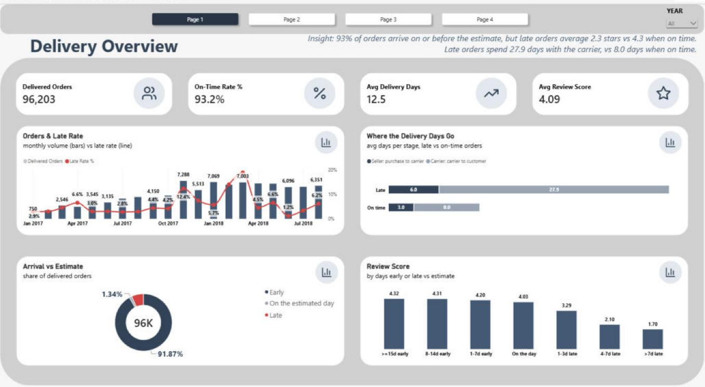
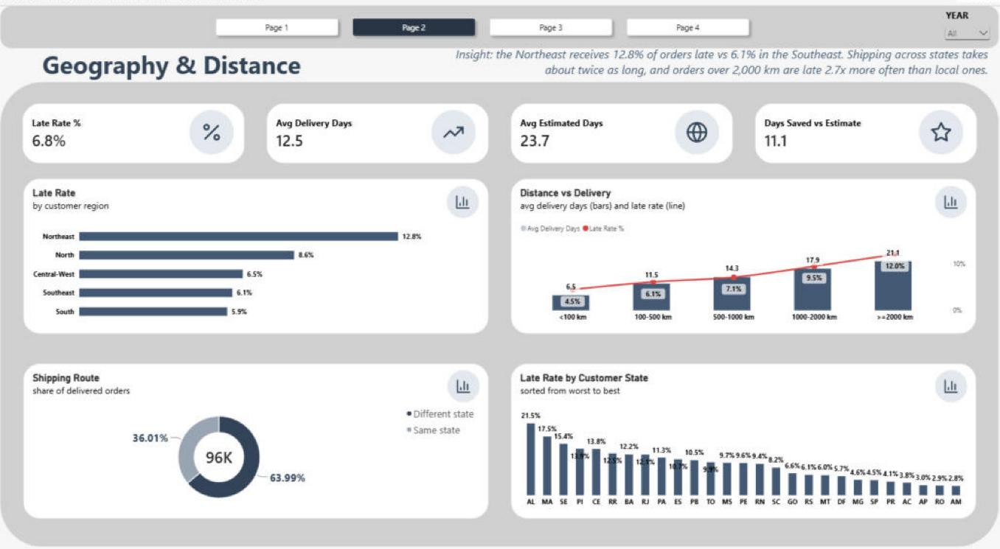
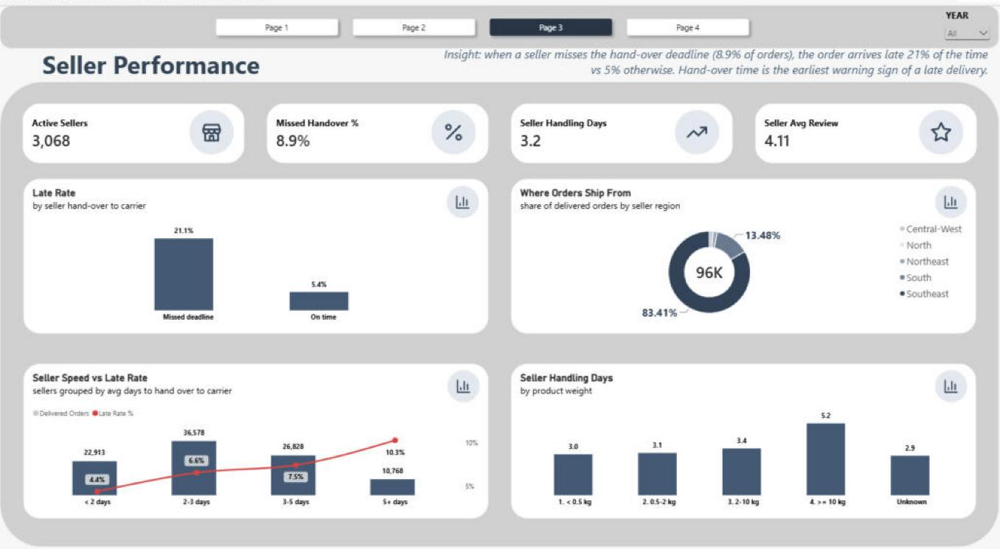
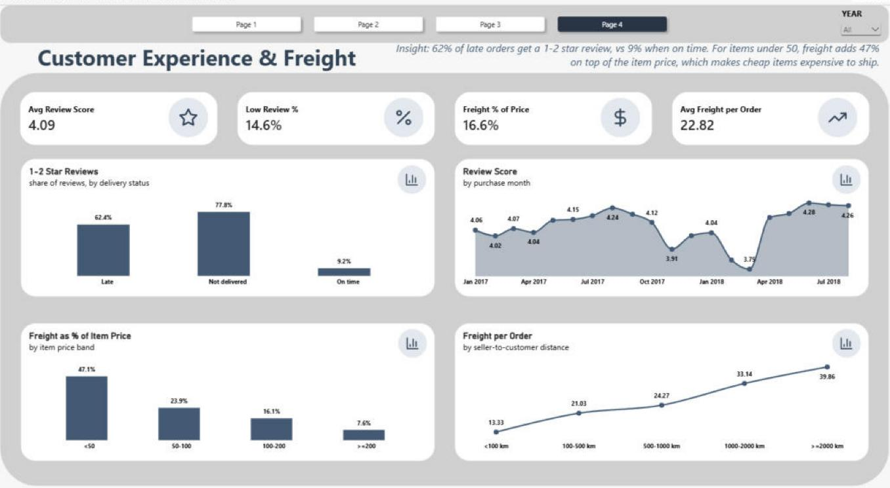

# Olist Delivery Performance Analysis (Python · SQL Server · Power BI)

Analisis operasional pengiriman sebuah marketplace e-commerce di Brasil: seberapa sering pesanan terlambat, di tahap mana waktu terbuang, siapa yang paling terdampak, dan bagaimana keterlambatan memengaruhi kepuasan pelanggan.

**Tools:** Python (pandas, numpy) · SQL Server 2025 Express (T-SQL) · SQL Server Management Studio 22 · Power BI Desktop (PBIP, DAX)



---

## 1. Pertanyaan bisnis

1. Berapa persen pesanan yang terlambat dari estimasi, dan apakah trennya membaik?
2. Di tahap mana waktu paling banyak terbuang: proses seller atau pengiriman oleh kurir?
3. Wilayah dan rute mana yang paling sering terlambat?
4. Seberapa besar keterlambatan menurunkan rating ulasan?
5. Seller seperti apa yang menyebabkan keterlambatan?
6. Apakah ongkos kirim wajar dibanding harga barang dan jarak?

## 2. Data

- Sumber: [Brazilian E-Commerce Public Dataset by Olist](https://www.kaggle.com/datasets/olistbr/brazilian-ecommerce) (Kaggle, lisensi CC BY-NC-SA 4.0). Data transaksi **asli** yang dianonimkan.
- **9 tabel yang saling berelasi:** orders, order_items, payments, reviews, customers, sellers, products, geolocation, dan terjemahan kategori. Totalnya sekitar 99 ribu order, 112 ribu item, dan 1 juta baris geolokasi.
- **Periode analisis: Jan 2017 – Agu 2018.** Data 2016 (329 order) dan Sep–Okt 2018 (20 order) tidak lengkap, sehingga tidak dipakai untuk tren.

```
customers ──< orders ──< order_items >── products
                │              │
                │              └──> sellers
                ├──< order_payments
                └──< order_reviews
```

## 3. Proses

**a. Profiling dan cleaning dengan Python** ([`python/clean_olist.py`](python/clean_olist.py))

Profiling awal menemukan sekitar 12 masalah kualitas data. Prinsip yang dipakai: data janggal **ditandai** (kolom `flag_*`), tidak diubah diam-diam.

| Masalah | Penanganan |
|---|---|
| Geolokasi: 1 juta baris untuk 19 ribu kode pos, 261 ribu duplikat, 33 titik di luar Brasil | Hapus duplikat dan titik di luar Brasil, lalu rangkum menjadi 1 titik per kode pos (median koordinat) |
| Nama kota tidak seragam ("sao paulo" vs "são paulo") | Normalisasi: huruf kecil, tanpa aksen |
| 551 order punya lebih dari 1 ulasan | Pakai ulasan terakhir per order |
| 166 order diserahkan ke kurir *sebelum* dibeli, dan 23 diterima *sebelum* diserahkan | Ditandai dan dikeluarkan dari perhitungan durasi |
| 610 produk tanpa kategori, dan 2 kategori tanpa terjemahan | Label "unknown" dan terjemahan manual |
| Berat produk 0 g, ongkir 0, pembayaran 0 | Berat dikosongkan, sisanya ditandai |

Script juga menghitung kolom baru: durasi tiap tahap (approval, seller, kurir, total), `delay_days`, `is_late`, dan **jarak seller → pelanggan** (rumus haversine). Validasi akhir memakai `assert`.

**b. Database SQL Server** ([`sql/01_setup.sql`](sql/01_setup.sql))
- Data dimuat ke tabel staging bertipe teks, lalu dikonversi ke 8 tabel bertipe dengan `TRY_CAST`.
- **Integritas data dijaga di level database:** primary key (termasuk primary key gabungan `order_id + order_item_id`), foreign key, dan check constraint (rating 1–5, harga > 0).
- Audit load: jumlah baris, total harga (13.591.643,70), dan angka kunci sama persis dengan hasil Python.

**c. Star schema** ([`sql/02_star_schema.sql`](sql/02_star_schema.sql))
- 2 view fakta dengan grain berbeda: `vw_fact_orders` (per order, untuk pengiriman dan rating) dan `vw_fact_order_items` (per item, untuk seller, produk, dan ongkir).
- 3 view dimensi (customer, seller, product) dan tabel referensi `dim_state` (nama dan wilayah 27 negara bagian).
- **Mencegah fan-out:** item dan pembayaran diagregasi per order sebelum di-JOIN. Tanpa langkah ini, total harga membengkak dari 13,59 jt menjadi 14,21 jt (+4,5%). Buktinya ada di file.

**d. Analisis SQL** ([`sql/03_analysis.sql`](sql/03_analysis.sql))

12 query dalam 5 tema: kinerja pengiriman, geografi, pengalaman pelanggan, performa seller, dan ongkos kirim. Teknik yang dipakai: JOIN multi-tabel, CTE berlapis, `PERCENTILE_CONT` (median), `NTILE`, `RANK`, `SUM(COUNT(*)) OVER ()`, `HAVING` untuk sampel minimal, dan `MAX(CASE ...)`.

**e. Power BI** (`powerbi/Olist_Delivery.pbip`, `Olist_Delivery.pbix`)
- Import dari view SQL Server, model **star schema**: `fact_orders`, `fact_order_items`, `dim_customer`, `dim_seller`, `dim_product`, dan `Calendar` (date table).
- 30 measure DAX dalam folder Delivery, Experience, Sellers, Freight, Items, dan Display. Semua angka utama dicocokkan dengan hasil SQL.
- Disimpan juga dalam format **PBIP** (Power BI Project), sehingga halaman dan model tersimpan sebagai file teks dan perubahannya bisa dilacak di Git.

## 4. Isi dashboard

| Halaman | Fokus | Visual utama |
|---|---|---|
| 1. Delivery Overview | Ketepatan waktu secara umum | **Combo chart** volume order vs tingkat keterlambatan per bulan, **stacked bar** "ke mana hari pengiriman habis" (seller vs kurir, terlambat vs tepat waktu), **donut** kedatangan vs estimasi, rating per kelompok keterlambatan |
| 2. Geography & Distance | Wilayah dan jarak | Keterlambatan per region, **combo chart** jarak vs lama kirim dan keterlambatan, **donut** rute satu negara bagian vs lintas negara bagian, keterlambatan untuk 27 negara bagian |
| 3. Seller Performance | Peran seller | Keterlambatan menurut ketepatan serah ke kurir, **donut** asal pengiriman per region seller, **combo chart** kecepatan seller vs keterlambatan, waktu proses per kelas berat |
| 4. Customer Experience & Freight | Kepuasan dan ongkir | Ulasan 1–2 bintang per status pengiriman, **area chart** tren rating bulanan, ongkir sebagai % harga, **line chart** ongkir per jarak |

Setiap halaman punya satu kalimat **insight** di kanan atas, dan slicer **YEAR** yang tersinkron di semua halaman.

## 5. Temuan utama

1. **Keterlambatan adalah pendorong terbesar ulasan buruk.** Rating order tepat waktu **4,29**, sedangkan order terlambat **2,27**. Sebanyak 62% order terlambat mendapat ulasan 1–2 bintang (vs 9% saat tepat waktu). Order terlambat hanya 6,8% dari order terkirim, tetapi menyumbang **36,8% ulasan bintang 1**.
2. **Waktu paling banyak hilang di tahap kurir.** Pada order terlambat, waktu kurir 27,9 hari (3,5x lebih lama dari normal), sedangkan waktu proses seller 6,0 hari (2x).
3. **Batas serah ke kurir adalah sinyal dini.** Saat seller melewati batas waktu serah ke kurir (8,9% order), peluang order terlambat naik hampir **4x** (21,1% vs 5,4%). Seller yang rata-rata butuh 5+ hari untuk menyerahkan barang terlambat 10,3%, dibanding 4,4% untuk seller yang butuh kurang dari 2 hari.
4. **Estimasi terlalu konservatif.** Janjinya rata-rata 23,7 hari, kenyataannya 12,6 hari, dan **92% order tiba lebih cepat** dari estimasi. Waktu tunggu yang tampil saat checkout bisa membuat calon pembeli batal.
5. **Geografi dan jarak.** Wilayah Timur Laut terlambat **12,8%** (Alagoas 21,5%), sedangkan Tenggara 6,1%. Pengiriman lintas negara bagian 2x lebih lama (15,1 vs 7,9 hari), dan di atas 2.000 km risiko terlambat **2,7x** lebih besar daripada di bawah 100 km.
6. **Lonjakan musiman.** Keterlambatan melonjak saat Black Friday (Nov 2017: 12,4%, ketika volume naik 63%) dan Feb–Mar 2018 (hingga 19%).
7. **Ongkir memberatkan barang murah.** Untuk barang di bawah 50, ongkir setara **47%** dari harga barangnya.

## 6. Rekomendasi

- **Pantau batas serah ke kurir setiap hari** dan beri peringatan atau sanksi ke seller yang sering melewatinya, karena ini indikator paling awal sebelum pelanggan mengeluh.
- **Evaluasi kinerja kurir per wilayah**, terutama Timur Laut dan Rio de Janeiro, dan pertimbangkan gudang atau mitra kurir regional.
- **Kalibrasi ulang estimasi pengiriman** per rute, supaya lebih realistis tanpa menaikkan tingkat keterlambatan.
- **Siapkan kapasitas pengiriman sebelum musim ramai**, misalnya Black Friday.
- **Gratis ongkir dengan minimum belanja** untuk mendorong pembeli barang murah menambah keranjang.

## 7. Cara menjalankan ulang

1. Unduh dataset dari Kaggle, lalu ekstrak ke folder `archive/`.
2. **Cleaning:** buat virtual environment dan pasang dependensi, lalu jalankan script.
   ```bash
   python -m venv .venv
   .venv\Scripts\pip install -r requirements.txt
   .venv\Scripts\python python/clean_olist.py
   ```
   Hasilnya 8 CSV di folder `clean/`.
3. **SQL Server (SSMS):** jalankan `sql/01_setup.sql` (ubah path CSV jika perlu), `sql/02_star_schema.sql`, lalu `sql/03_analysis.sql`.
4. **Power BI:** buka `Olist_Delivery.pbix` (data sudah tersimpan di file), atau buka `powerbi/Olist_Delivery.pbip` lalu klik **Refresh** dengan koneksi ke `.\SQLEXPRESS`, database `OlistDB`.

Data mentah (45 MB) dan CSV hasil cleaning tidak disertakan di repository karena ukurannya. Keduanya bisa dibuat ulang lewat langkah 1–2.

## Struktur folder

```
├── README.md
├── Olist_Delivery.pbix              dashboard Power BI
├── requirements.txt                 versi pandas dan numpy
├── python/
│   └── clean_olist.py               profiling dan cleaning
├── sql/
│   ├── 01_setup.sql                 database, PK/FK, audit load
│   ├── 02_star_schema.sql           view fakta dan dimensi
│   └── 03_analysis.sql              12 query analisis + insight
├── powerbi/                         proyek Power BI (format PBIP, berbasis teks)
└── images/                          screenshot dashboard
```

## Screenshot

| | |
|---|---|
|  |  |
|  |  |
